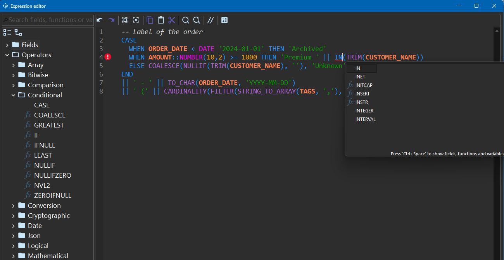

////
Licensed to the Apache Software Foundation (ASF) under one
or more contributor license agreements.  See the NOTICE file
distributed with this work for additional information
regarding copyright ownership.  The ASF licenses this file
to you under the Apache License, Version 2.0 (the
"License"); you may not use this file except in compliance
with the License.  You may obtain a copy of the License at
  http://www.apache.org/licenses/LICENSE-2.0
Unless required by applicable law or agreed to in writing,
software distributed under the License is distributed on an
"AS IS" BASIS, WITHOUT WARRANTIES OR CONDITIONS OF ANY
KIND, either express or implied.  See the License for the
specific language governing permissions and limitations
under the License.
////
= Hop Expression Plugin
:url-repo: https://github.com/nadment/hop-expression
:url-doc: {url-repo}/blob/main/src/main/doc
:url-icons: https://raw.githubusercontent.com/nadment/hop-expression/main/src/main/resources
:url-ci: {url-repo}/actions/workflows/maven.yml
:url-sonarcloud: https://sonarcloud.io/dashboard?id=hop-expression

image:{url-ci}/badge.svg[Java CI build,link={url-ci}]
image:https://sonarcloud.io/api/project_badges/measure?project=hop-expression&metric=alert_status[Quality gate,link={url-sonarcloud}]
image:https://sonarcloud.io/api/project_badges/measure?project=hop-expression&metric=coverage[Coverage,link={url-sonarcloud}]

A plugin for https://hop.apache.org[Apache Hop] that brings a SQL-like expression language to pipelines and workflows.

Documentation: {url-doc}/hop-user-manual/expression/expression.adoc[expression language] | {url-doc}/hop-user-manual/expression/editor.adoc[expression editor] | {url-doc}/hop-user-manual/expression/functions.adoc[functions]

== Features

The plugin provides 4 transforms and 2 actions that use the power of the expression language.

[cols="1,3,10"]
|===
| |Name |Description

3+|Transforms

|image:{url-icons}/expression.svg[Expression,24,24]
|{url-doc}/hop-user-manual/pipeline/transforms/expression.adoc[`Expression`]
|Calculates fields with expressions.

|image:{url-icons}/route.svg[Route,24,24]
|{url-doc}/hop-user-manual/pipeline/transforms/route.adoc[`Route`]
|Routes rows to target transforms according to expression conditions.

|image:{url-icons}/where.svg[Where,24,24]
|{url-doc}/hop-user-manual/pipeline/transforms/where.adoc[`Where`]
|Filters rows and keeps only those where the expression is true.

|image:{url-icons}/aggregate.svg[Aggregate,24,24]
|{url-doc}/hop-user-manual/pipeline/transforms/aggregate.adoc[`Aggregate`]
|Calculates values on groups of rows with aggregate functions; the input does not need to be sorted.

3+|Actions

|image:{url-icons}/set-variable.svg[Set variable,24,24]
|{url-doc}/hop-user-manual/workflow/actions/setvariable.adoc[`Set variables expression`]
|Sets or modifies variables with expressions.

|image:{url-icons}/loop.svg[Loop,24,24]
|{url-doc}/hop-user-manual/workflow/actions/loop.adoc[`Loop`] (experimental)
|Executes a workflow in a loop while a condition expression is true.
|===

== Expression language

An expression is a combination of one or more literal values, resolvable identifiers, operators and functions that evaluate to a value.

----
/**
 * Multi line comment
 */

case
  when REGION_ID<0 then Upper(Left(LABEL,5))
  when REGION_ID between 0 and 100 then InitCap(Substr("LABEL FR",8,50))
  else To_Char("YEAR"+1,'FM9999') || ' XXX '
end
----

A few more examples:

----
LAST_DAY(ORDER_DATE + INTERVAL 1 MONTH)                 -- Date arithmetic
TO_CHAR(ORDER_DATE, 'YYYY-MM-DD')                       -- Formatting
AMOUNT::NUMBER(10,2)                                    -- Cast
COALESCE(NULLIF(TRIM(NAME), ''), 'Unknown')             -- Null handling
JSON_VALUE(CUSTOMER, '$.address.city')                  -- JSON path
FILTER(STRING_TO_ARRAY(TAGS, ','), t -> t <> '')        -- Array and lambda
REDUCE(TRANSFORM(STRING_TO_ARRAY(PRICES, ','), p -> TO_NUMBER(p)), (acc, p) -> acc + p)
----

=== Data types and literals

* 11 data types: `Boolean` `Integer` `Number` `String` `Date` `Timestamp` `Interval` `Binary` `Json` `Inet` `Array`
* Literal values: `TRUE`, `FALSE`, `NULL`, 'String', 1234, -45e-2, 0xF0A1, 0b10110111, `DATE` '2022-04-25', `TIMESTAMP` '2022-04-25 05:28:59', `BINARY` 'FA6CB', `JSON` '{"name":"John"}', `INTERVAL` 3 `YEAR`
* Arrays `[1,4,8]` and access to an element with `<array>[1]`

=== Operators

* Logical operators `NOT` `AND` `OR` `XOR`
* Arithmetic operators `+` `-` `*` `/` `%`
* Comparison operators `>` `>=` `<` `<=` `=` `!=` `<>` `BETWEEN` `IN` `IS TRUE` `IS FALSE` `IS NULL` `IS DISTINCT FROM`
* Concatenation operator `||`
* Conditional operators `CASE WHEN` `COALESCE` `IF` `IFNULL` `NULLIF` `ZEROIFNULL` `NULLIFZERO` `GREATEST` `LEAST`
* Pattern matching operators `LIKE` `ILIKE` `SIMILAR TO`
* Cast operator `::` or `CAST`(<value> `AS` <type> `FORMAT` <format>)
* Time zone operator `AT TIME ZONE`
* Array element operator `<array>[<index>]`

=== Functions

* Over 240 scalar and aggregate {url-doc}/hop-user-manual/expression/functions.adoc[functions]: conditional, mathematical, trigonometry, conversion, bitwise, string, date, JSON, array...
* {url-doc}/hop-user-manual/expression/udf.adoc[User-defined functions] (UDF), stored as metadata of the project and written as expressions
* {url-doc}/hop-user-manual/expression/expression.adoc#lambda[Lambda expressions] to process the elements of an array with `TRANSFORM`, `FILTER`, `EXISTS`, `REDUCE` and `ARRAY_SORT`, like `TRANSFORM(STRING_TO_ARRAY(PRICES, ','), p -> TO_NUMBER(p) * 1.2)`

=== Good to know

* Keywords and function names are not case-sensitive, identifiers are
* Comments are supported to make expressions easier to read
* The {url-doc}/hop-user-manual/expression/editor.adoc[expression editor] highlights the syntax, completes the names, explains the elements and underlines the errors
* Parentheses control the order of evaluation
* An expression is optimized right after parsing: `5+XYZ+4*2+5` becomes `XYZ+18`, so readability has no cost at runtime

== Getting started

=== System requirements

* https://hop.apache.org[Apache Hop] 2.20 or above
* Hop Web is not supported, because the expression editor uses JFace

=== Installation

. Download the plugin archive from the {url-repo}/releases[releases] page
. Unzip the archive so that the plugin ends up in the `plugins/misc/expression` directory of your Hop installation
. Restart Hop

=== Samples

Sample pipelines are provided in the {url-repo}/tree/main/src/main/resources/demo[demo] directory:
`demo_expression.hpl`, `demo_expression_json.hpl`, `demo_route.hpl` and `demo_aggregate.hpl`.

== Building from source

The build requires a JDK 21 or above and Maven.

----
mvn clean package
----

The plugin archive is created in `target/hop-expression-<version>.zip`.

NOTE: `mvn install` also unzips the archive into the `custom` directory of the Hop installation designated by the `hop.home` property.

== Extending with plugins

Add your own function from another plugin with a class that extends `Function`, annotated with `@FunctionPlugin`: it declares the name, the return type and the operand types of the function, and implements its evaluation.

The {url-doc}/hop-dev-manual/function-plugin.adoc[developer guide] gives a complete example and explains the setup, the aggregate functions, the functions with an extended syntax, the documentation, the deployment and the tests.

== Support

This plugin is provided as is, without any warranties, expressed or implied. This software is not covered by any Support Agreement.

== License

Licensed under the https://www.apache.org/licenses/LICENSE-2.0[Apache License, Version 2.0].
